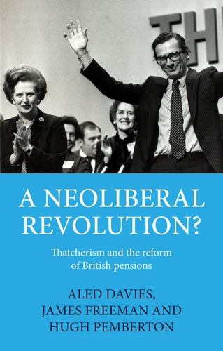

```{python}
#| echo: false
#| output: asis
# Passes the seat totals in data/commons-seats.csv to the chamber chart in the hero
import pandas as pd
seats = pd.read_csv("data/commons-seats.csv")
print("```{=html}")
print(f'<script id="seats-data" type="application/json">{seats.to_json(orient="records")}</script>')
print("```")
```

```{=html}
<section class="hero">
  <div class="wrap hero-grid">
    <div class="hero-text">
      <h1 class="hero-name">James Freeman</h1>
      <p class="hero-lede">History, politics and data: writing on modern British politics, visualisations of its numbers, and occasional notes on higher education and teaching.</p>
      <p class="hero-role">Senior Academic Fellow in History and Associate Pro Vice-Chancellor (Education), Faculty of Arts, Law and Social Sciences, University of Bristol.</p>
      <p class="hero-links"><a href="publications.html">Publications</a><a href="#about">About and contact</a></p>
    </div>
    <figure class="hemi">
      <div class="hemi-head">
        <span class="hemi-caption">The House of Commons after the general election of</span>
        <span id="hemi-year" class="hemi-year">2024</span>
      </div>
      <svg id="hemicycle" viewBox="0 0 600 312" role="img" aria-label="House of Commons seats by party"></svg>
      <ul id="hemi-legend" class="hemi-legend"></ul>
      <div class="hemi-controls">
        <button id="hemi-play" type="button" aria-pressed="false">Play 1945 to 2024</button>
        <label class="visually-hidden" for="hemi-slider">Choose a general election</label>
        <input id="hemi-slider" type="range" min="0" max="21" step="1" value="21">
      </div>
      <figcaption class="hemi-note">Seats won at each general election since 1945. <a href="data/commons-seats.csv">Data (CSV)</a></figcaption>
    </figure>
  </div>
</section>
```

::::: {.band}

:::: {.wrap}

::: {.section-head}

## Research

:::

::: {.themes}

::: {.theme}

### Thatcherism and neoliberalism

How neoliberal ideas moved from think tanks into government, traced through pensions policy and the Number 10 Policy Unit.

:::

::: {.theme}

### Conservatism and freedom

The Conservative Party's language of liberty from Churchill to Thatcher, and where it did and did not owe a debt to neoliberalism.

:::

::: {.theme}

### Political promises and rhetoric

Why politicians make pledges, how their language changes over time, and what counting words can show that close reading misses.

:::

:::

::::

:::::

::::: {.band .band-book}

:::: {.wrap .book}

::: {.book-cover}

```{=html}
<a href="https://www.manchesteruniversitypress.co.uk/9781526146526/"></a>
```

:::

::: {.book-body}

Latest book, 2024

## [A Neoliberal Revolution? Thatcherism and the Reform of British Pensions](https://www.manchesteruniversitypress.co.uk/9781526146526/)

With Aled Davies and Hugh Pemberton. Manchester University Press.

Drawing on newly released archives, the book follows the Thatcher government's attempt to turn Britain into a nation of risk-taking savers through private personal pensions, and explains why the revolution it planned fell short.

[Buy from Manchester University Press](https://www.manchesteruniversitypress.co.uk/9781526146526/){.pill-link}

:::

::::

:::::

::::: {.band}

:::: {.wrap}

::: {.section-head}

## Selected articles
[All publications](publications.qmd)

:::

::: {#featured-articles}

:::

::::

:::::

::::: {.band}

:::: {.wrap .about #about}

::: {.about-text}

## About

I am a historian based at the University of Bristol who writes and teaches about both political history and alogrithmic societies.
:::

::: {.about-contact}

### Contact

```{=html}
<p><a href="#contact" class="js-email" data-user="james.freeman" data-host="bristol.ac.uk">Show email address</a></p>
```

[University of Bristol profile](https://www.bristol.ac.uk/people/person/James-Freeman-70685bc8-df87-4691-af8c-6d14e44f19ce/)

[Google Scholar](https://scholar.google.com/){.placeholder}

[GitHub](https://github.com/){.placeholder}

:::

::::

:::::

